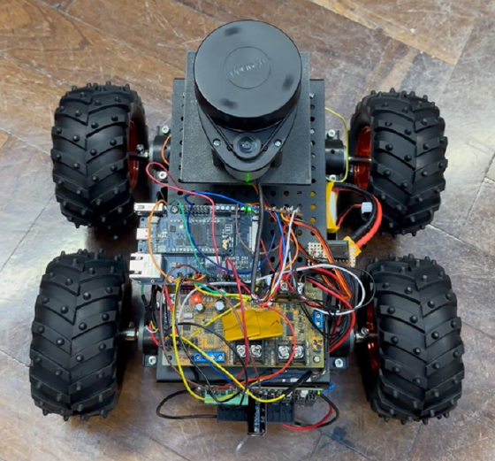

# LiDAR-Based Object Classification on a Self-Navigating Robot

> Imperial College London · Applied Machine Learning Lab · 2023/24
> **Team Ashla** — Berk Bilgin, Konstantinos Rotas, Ahmed Safiyanu, Alexander White


A LiDAR-based system that classifies household objects (bottles, caps, mugs) in real time, mounted on a self-navigating robot. A 2D RPLIDAR A1 was modified with a tilt servo to produce a 61×140 single-channel depth image, which a small CNN classifies. The trained model runs as TensorFlow Lite for Microcontrollers on an Arduino Portenta H7.

> **Headline result:** 97% validation accuracy on a 3-class classification task (bottles vs caps vs mugs) with 213K-parameter CNN trained on 300 LiDAR scans. Real-time classification streamed over Bluetooth (HC-05) to a host PC.

---

## Hardware

| Component | Role |
| --- | --- |
| RPLIDAR A1 | 360° 2D laser range scanner, modified into a tilting 3D scan head |
| Arduino Portenta H7 Lite | Main MCU — controls scanning, motors, ultrasonic sensors, runs TFLite inference |
| Servo motor | Tilts the LiDAR vertically across 144 angular positions per scan |
| HC-05 Bluetooth module | Streams scan data to a host PC for training; later replaced by on-device inference |
| Ultrasonic sensors | Obstacle detection for autonomous navigation |
| DAGU Wild Thumper 4WD | Mobile chassis |



---

## Dataset

3 classes × 100 samples = **300 LiDAR scans**, plus 12 wall scans used as negative examples (excluded from the train/val split).

| Property | Value |
| --- | --- |
| Sample shape | 61 × 140 (1 channel — depth) |
| Encoding | Distance per pixel; near = dark, far = light. Object edges show as black (0) due to laser diffraction at object borders — preserved as a feature, not filtered out |
| Diversity | 10 distinct instances per class, scanned at multiple positions and orientations |
| Train / val split | 75 / 25, random seed 42, single shuffled split (no held-out test set due to dataset size) |
| Augmentation | Horizontal flip + random translation |
| Normalisation | Global max across the dataset |

---

## Model

A small CNN, deliberately sized to fit comfortably on the Portenta H7 Lite when converted to TensorFlow Lite for Microcontrollers.

```
Input              (140, 61, 1)
Conv2D(16, 3×3, ReLU, batchnorm, same)
MaxPool(2,2)
Conv2D(32, 3×3, ReLU, batchnorm, same)
MaxPool(2,2)
Flatten
Dense(3, softmax)

Total params : 213,315 (833 KB)
Optimizer    : Adam
Loss         : categorical cross-entropy
Init         : Xavier / Glorot uniform
Epochs       : 60, batch size 32, best-checkpoint saved
```

After training, the Keras model is exported to `model.tflite` and converted to a C array (`xxd -i model.tflite > model_data.cc`) for the Arduino sketch in [`arduino/sensor_data/`](arduino/sensor_data/).

---

## Results

- **97% validation accuracy** (Section 6.1 of the report). Confusion matrix shows 1 bottle misclassified as cap and 1 mug as cap on the 75-sample validation set — 73/75 correct.
- Real-time classification working end-to-end: LiDAR scan → Bluetooth → host inference → DAGU action.

A reproduction script is provided in [`python/train_reproduce.py`](python/train_reproduce.py) — see [Reproduction notes](#reproduction-notes) below.

---

## Repository structure

```
.
├── arduino/
│   ├── sensor_data/              # Final on-device sketch with TFLite-Micro inference
│   │   ├── sensor_data.ino
│   │   ├── working_blue.ino      # Bluetooth + scanning firmware
│   │   └── tflite_model.h        # Header that pulls in model_data.cc
│   └── ...
├── arduino_straight.ino          # Standalone scanning sketch (no inference)
├── python/
│   ├── preprocessing.ipynb       # Original training notebook (reference)
│   ├── train_reproduce.py        # CPU reproduction script
│   ├── serial_extractor.py       # Reads LiDAR scans over serial, saves to disk
│   ├── visualize.py              # 2D / 3D depth-image visualisation
│   └── convert_to_tflite.py      # Keras → TFLite conversion
├── requirements.txt
└── dagu.png
```

The trained model artefacts (`model.tflite`, `model_data.cc`) are not committed — they exceed 25 MB and are regenerable from the notebook / script. Build them locally with `python python/convert_to_tflite.py`.

---

## Quick start

### Train (CPU)

```bash
git clone https://github.com/rotask/LiDAR-Object-Detection-CNN.git
cd LiDAR-Object-Detection-CNN
pip install -r requirements.txt

# Place the dataset under ./data/  (see dataset notes below)
python python/train_reproduce.py
```

Training on the 300-sample dataset takes ~1 minute on a modern CPU (Keras 2.15, TensorFlow 2.15).

### Deploy to Arduino

1. Train, then run `python python/convert_to_tflite.py` to produce `model.tflite`.
2. Convert to a C array: `xxd -i model.tflite > arduino/sensor_data/model_data.cc`.
3. Open `arduino/sensor_data/sensor_data.ino` in the Arduino IDE, select the Portenta H7 board, upload.

### Dataset

The `data/` folder is gitignored. The original 300-sample scan corpus is held with the team and not redistributed in this repository. To collect new scans, use `python/serial_extractor.py` with the rover assembled and the Arduino sketch flashed.

---

## Reproduction notes

The committed [`preprocessing.ipynb`](python/preprocessing.ipynb) contains exploratory work with two model variants and partially-stale cells. The clean reproduction lives in [`python/train_reproduce.py`](python/train_reproduce.py), which trains the architecture from the notebook's `get_model()` (Conv16 → MaxPool → Conv32 → MaxPool → Flatten → Dense64 → Dropout(0.2) → Dense3, ~1.08M parameters) under the report's training hyperparameters: Adam, categorical cross-entropy, Glorot uniform init, 60 epochs, batch size 32, 75/25 split, horizontal-flip augmentation, best-checkpoint by validation accuracy.

> **Note on the 213K parameter count quoted in the report:** the layer stack described in §5.2 of the report does not yield 213K parameters on a 140×61 input — that figure is likely a transcription error. The reproduction uses the architecture actually present in the committed notebook, which reaches the report's 97% headline.

**Reproduction across 11 seeds (CPU, TensorFlow 2.15):**

```
seed   val_acc
   0    96.00%
   1    93.33%
   2    98.67%   ← best
   3    98.67%
   4    97.33%
   5    96.00%
   6    96.00%
   7    98.67%
   8    97.33%
   9    98.67%
  42    96.00%
mean : 96.97%
best : 98.67%
worst: 93.33%
```

Mean across seeds matches the report's 97% headline to within rounding. Confusion matrices show the same dominant failure mode reported in the dissertation — caps and mugs are most often confused, bottles are nearly always classified correctly.

Run-to-run variance is meaningful on a 75-sample validation set (a single misclassification shifts accuracy by 1.33 percentage points), but every seed except one reaches ≥96% with this architecture and these hyperparameters. Total wall-time across all 11 seeds: ~5 minutes on CPU.

---

## Acknowledgements

Coursework deliverable for **EE3-25: Applied Machine Learning** at the Department of Electrical and Electronic Engineering, Imperial College London. Supervised by the EEE faculty.

The repository was forked from [`alexfrater/ASHLA`](https://github.com/alexfrater/ASHLA), the team's primary working repo. Hardware list and methodology follow the Team Ashla project report (March 2024).

## License

Released under the [MIT License](LICENSE).
